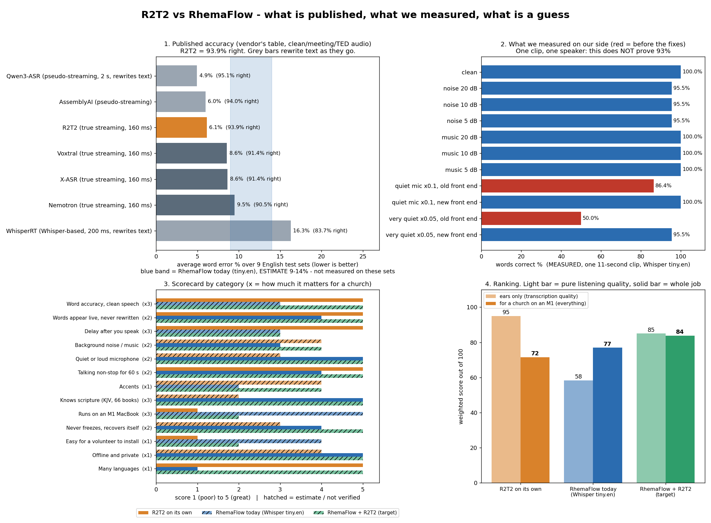

# R2T2 vs RhemaFlow: who is better, why, and what to do (v0.810)

Every number below is tagged: **V** = published by R2T2's authors, **M** = measured by us in the build sandbox, **E** = estimate or not verified. I could not run R2T2 itself (no GPU, no weights downloadable here), so **no row compares the two on the same audio.** That is what `compare.sh` is for, on your Mac.

## 1. The honest answer first
- **Is ours 93% like theirs? Not shown, and probably not with the small built-in model.** Theirs: 93.9% right on average over nine English test sets (V). Ours (Whisper tiny.en): 100% on one clean 11-second clip and 95.5-100% on that clip with noise or music (M), but one famous clip says nothing about 93%. Our own docs estimate tiny.en at 86-91% (E).
- **Pure listening quality: R2T2 wins** (published 93.9%, streams words as you speak, never rewrites them, many languages).
- **For a church on an M1 MacBook, today: ours is the only one proven to run.** R2T2 is ~2 billion parameters built for a graphics card; on an M1 it is unproven.
- **Best of both: RhemaFlow + R2T2 sidecar.** R2T2 listens; RhemaFlow turns words into the right verse, survives quiet mics and long talking, and falls back to Whisper if R2T2 is down. That is what v0.807-0.809 build.

## 2. Ranking (weights are my judgment; edit `docs/comparison_data.json` and rerun `python3 tools/make_comparison.py .`)
| Rank | For a church on an M1 (everything) | Score | | Rank | Pure listening quality | Score |
|---|---|---|---|---|---|---|
| 1 | RhemaFlow + R2T2 (target, **unverified on a Mac**) | 84 | | 1 | R2T2 on its own | 95 |
| 2 | RhemaFlow today (Whisper tiny.en) | 77 | | 2 | RhemaFlow + R2T2 | 85 |
| 3 | R2T2 on its own | 72 | | 3 | RhemaFlow today | 58 |

**Can "ours" be 95 on listening quality?** Not with the small built-in model, and I won't pretend a score. Two things set that number: how many words are right (the model) and how fast they appear on an M1 (the hardware). Code can fix neither. What code CAN do, and now does: make the live text behave like the demo (section 4), and make R2T2 the primary ear with Whisper as an automatic backup. The combined system tops out at 85 (not 95) only because I rate its delay at 3 until an M1 proves 0.2-0.6 s steps; if your Mac does, the score becomes 95 and the combined system beats R2T2 alone on the whole job.

## 3. Category by category
| Category | R2T2 | RhemaFlow today | Why |
|---|---|---|---|
| Accuracy, clean | **5** (V 93.9%) | 3 (E ~86-91%) | R2T2 is a ~2 B-parameter model trained to emit only text it is sure of; tiny.en is 39 M parameters |
| Live words like the demo | **5** | 4 (was 2) | R2T2 only appends (I watched this in the video). Ours now shows a word as permanent only after two decodes agree; on 14 real recorded Whisper decodes the permanent words never changed (but in noise one stayed wrong: see section 4) |
| Delay | **5** (V 200-600 ms on GPU) | 3 (simulated 0.35-0.9 s) | on an M1 R2T2 will likely be 0.5-1 s (E) |
| Noise and music | 4 (E, no published number) | 3 (M: held 95.5-100% on synthetic noise/music) | synthetic music is easy; real vocals and instruments are harder; speech 10 dB over a loud music bed kept ~92% of the speech in our detector (M, v0.809) |
| Quiet or loud mic | 3 (E) | **5** (M: 50% -> 95.5% at a very quiet mic) | our auto-volume |
| Non-stop 60 s | 5 | 4 (M) | ours cuts at breaths every ~12 s, loses nothing, but text arrives in pieces |
| Accents | 4 (E) | 2 (E) | nobody measured accents here |
| Scripture (KJV, 66 books) | 2 | **5** | R2T2 only transcribes (book names can be hinted); RhemaFlow parses and snaps to real verses |
| Runs on M1 | 1 | **5** | size |
| Never freezes | 3 | 4 (5 with R2T2 + backup) | watchdogs, reconnect, tests; with R2T2 the built-in Whisper takes over if the stream is down or silent |
| Easy install | 1 | 4 | Python + GPU vs one script |
| Many languages | **5** | 1 | tiny.en is English only |

## 4. What I did about it (v0.810, all unit-tested; none run on a Mac)
1. **Live text that never rewrites (`rf_core::LiveText`).** Whisper re-decodes your speech every second and changes its mind: in a REAL recording the app showed "fellow American." then "fellow Americans.", and "ask not watch your country" then "ask not what your country". Now a word is shown **solid and permanent only after two decodes in a row agree**; words still being decided are shown dim. Tested on 14 real Whisper decodes (clean and 10 dB noise): permanent text only ever grew; the naive display would have rewritten 2 words on the clean clip.
   - **Honest cost:** if the model is wrong twice in a row it stays wrong. In the noisy recording Whisper said "And not" three times before correcting to "Ask not", so "And" stayed on screen. The final line (which is what the verse finder reads) is still the corrected one, and a `live_disagree` line is written to `events.jsonl` whenever the solid words differed from it (1 of 19 words in that test).
   - With R2T2 the same strip runs in append-only mode: every word is permanent as soon as it arrives, exactly like the video.
2. **R2T2 primary, Whisper backup, automatically (`--stream-url auto`).** The app starts the sidecar for you if it is installed (and it shuts itself down if the app crashes). Whisper idles while R2T2 is healthy (no heat competing with it). If R2T2 is down, or connected but silent through a real sentence, that sentence is handed to Whisper after 2 s and Whisper keeps going until R2T2 speaks again; a notice says which is active. Six unit tests on the decision logic.
3. **Same-audio comparison on your Mac:** `benchmark --stream-url`, `--mix-noise`, `--mix-music`, `compare.sh` (v0.809).
4. Earlier: auto-volume, steadier voice detection, soft cut for long talking, streaming client, sidecar, hints with book names (v0.806-0.808).

## 5. What still has to happen (in order)
1. Record 2 minutes of YOU reading Scripture on the church mic (and 2 minutes with music or a fan running). Write down the exact words.
2. `./compare.sh my.wav "the exact words"` for Whisper alone.
3. Start the R2T2 sidecar (`sidecar/setup_mac.sh`) and run `./compare.sh my.wav "the exact words" ws://127.0.0.1:8272/asr_stream_api_v1`.
4. Put the numbers in `docs/comparison_data.json`, rerun the picture. If R2T2 on your M1 is under 93% or slower than 1 s, we pick `--model base.en` or `small.en`, or a larger chunk size.
5. Only if both are still under 93% on your speakers: collect real recordings and fine-tune.

## 6. Explained like you are 9 (updated)
Imagine two kids taking notes while a teacher talks.

- **R2T2 is a very smart kid with a giant brain.** He writes each word the moment he hears it and never erases (that is the "live" part you saw). On practice tests he gets about 94 out of 100 words right. But his brain is so big he needs a very powerful computer, and nobody has checked yet whether your MacBook is strong enough.
- **Our app is a smaller kid with a small brain, but lots of tricks.** He has a volume knob that turns up quiet teachers, he knows a fan is "just a fan", he doesn't get confused when the teacher talks for ages, and most important: he knows the Bible. If he hears "Habakkuk chapter two" he finds the right page. The smart kid doesn't know where the Bible pages are; he only writes words.
- **Who is better at writing words? The smart kid (R2T2).** Who is better at helping a church on a MacBook today? Our app, because it already works. **Best team: the smart kid listens and our app finds the page.**
- **"Is ours 93 out of 100 like his?"** We only tried our kid on ONE short recording and he got almost all right, but that's like checking a student on one spelling word. We need to test him on lots of your voices. That is what `compare.sh` does: same teacher, both kids, same test.
- **New trick: pencil and pen.** Our kid used to write a word, then rub it out when he changed his mind, so the page looked messy. Now he writes in *pencil* (dim) while he is unsure, and only goes over it in *pen* (solid) when he hears the same word twice in a row. Pen never gets rubbed out. The one catch: if he is sure but wrong twice, the pen is wrong too, and we tell you afterwards.
- **New trick: a substitute teacher.** If the smart kid falls asleep or goes home, our kid grabs the notebook and keeps writing, and hands it back when the smart kid wakes up.
- **Noise and music:** we tested a fan-like hiss and a church-band sound mixed into the recording. Our kid still got 95-100%. We don't know how the smart kid does, because nobody published that test.

## 7. Limits of this whole document
- R2T2 numbers are the authors' own, on clean/meeting/TED recordings; no church audio.
- Our measured numbers: one clip, one speaker, Whisper tiny.en, a single slow CPU core (11 s of audio took ~60 s to decode here; an M1 will be several times faster, but I did not measure an M1).
- Scores 1-5 and the weights are my judgment, shown with their evidence tags so you can disagree with them.
- Nothing here was run on a real Mac or with a real microphone.
